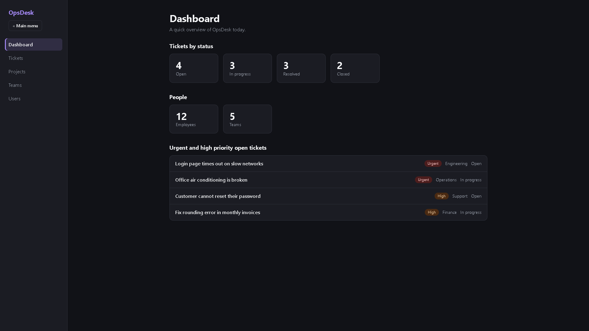
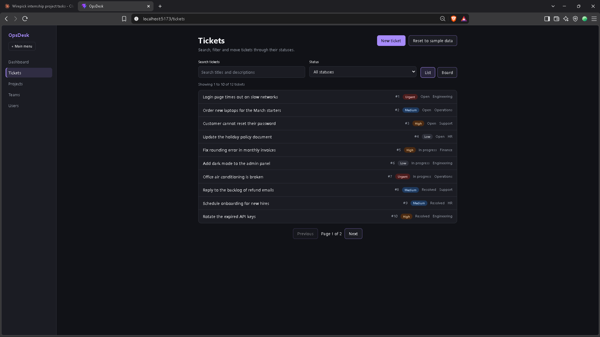
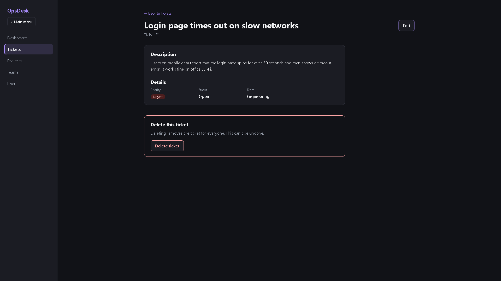
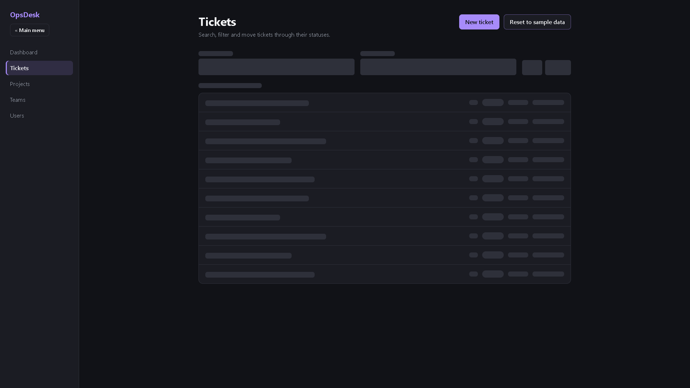
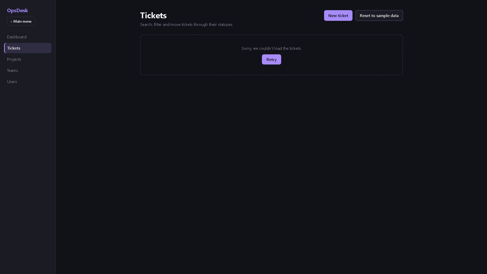
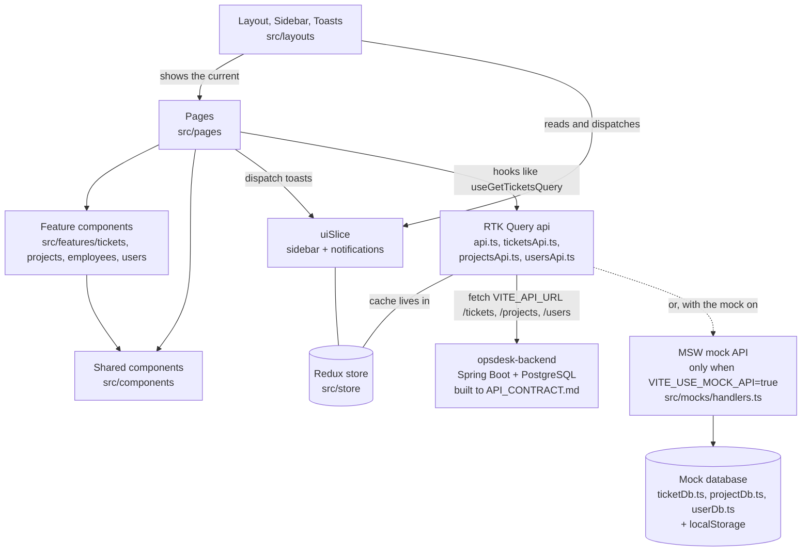

# OpsDesk

OpsDesk is an internal operations dashboard. Staff raise support **tickets**, move them through a simple workflow (Open → In progress → Resolved → Closed) on a list or a board, and see what each team is working on through **projects**, **teams** and a **users** directory. It was built over four weeks of an internship as a React 19 + TypeScript frontend.

> **The app talks to a real backend:** [opsdesk-backend](https://github.com/Stormmzyy/opsdesk-backend), a Spring Boot API with PostgreSQL, built in Week 6 against [API_CONTRACT.md](API_CONTRACT.md).
>
> **Or it can run with no backend at all.** Set `VITE_USE_MOCK_API=true`, and [Mock Service Worker (MSW)](https://mswjs.io/) answers the app's `/api/v1/...` requests inside the browser instead, following the same contract. See [Getting started](#getting-started) for both.

## Contents

- [Features](#features)
- [Screenshots](#screenshots)
- [Getting started](#getting-started)
- [Environment variables](#environment-variables)
- [Scripts](#scripts)
- [Tests](#tests)
- [Architecture](#architecture)
- [Further documentation](#further-documentation)
- [Accessibility](#accessibility)
- [Security](#security)
- [Known limitations](#known-limitations)
- [Git workflow](#git-workflow)

## Features

- **Dashboard:** ticket counts by status, people and team counts, and the urgent and high priority tickets still open.
- **Tickets:**
  - A **list** with search (titles and descriptions), a status filter and pages of 10, or a **board** with one column per status. The view is kept in the URL (`/tickets?view=board`).
  - **Create**, **edit**, **move** (one click to the next status, or pick any status) and **delete** tickets. Deleting asks first, in an accessible confirmation dialog.
  - Form validation with errors linked to their fields.
- **Projects:** project cards, each with its own page (`/projects/:id`).
- **Teams:** a summary of each team's members and open tickets, plus a searchable Employee Directory.
- **Users:** the user directory, from `GET /api/v1/users`.
- **Polished states:**
  - **Skeleton** placeholders shaped like the real content while data loads, with no shimmer for people who ask their system for less motion.
  - **Helpful empty states** with a way out, such as "Clear filters".
  - **Error states** with a Retry button.
- **Toast notifications** for success and failure. Success and info toasts dismiss themselves after 6 seconds, pausing while hovered or focused; errors stay until dismissed.
- **Resilience:** two error boundaries catch a crashing page or layout and show a friendly fallback instead of a blank screen.
- **Accessible:**
  - Keyboard-only navigation and a skip link.
  - Focus moved sensibly after every page change, dialog and dismissal.
  - Live regions for announcements, labelled fields, and contrast measured in light and dark mode.
- **Light and dark mode** that follow the system setting, and a layout that works from phone to desktop width.

## Screenshots

| Dashboard | Tickets (list) |
| --- | --- |
|  |  |

| A ticket | Loading | Error |
| --- | --- | --- |
|  |  |  |

[docs/screenshots/README.md](docs/screenshots/README.md) explains what each image shows and how to take it.

## Getting started

### Prerequisites

- [Node.js](https://nodejs.org/) **22** (22.12 or newer) or **20.19** or newer. Vite 8 needs one of these.
- npm, which comes with Node.js.
- Git.

### Install

```bash
git clone https://github.com/Stormmzyy/opsdesk-frontend.git
cd opsdesk-frontend
npm install
cp .env.example .env     # on Windows Command Prompt: copy .env.example .env
```

**Copying `.env.example` is required.** Without a `.env` file, the app sends its requests to `/api/v1` on the Vite dev server itself, which has no API, and the mock is off, so every page shows its "couldn't load" error.

### Run it against the real backend (the default)

1. Start the backend: follow the [opsdesk-backend README](https://github.com/Stormmzyy/opsdesk-backend#readme) to start its database and run `./mvnw spring-boot:run`. It serves the API at http://localhost:8080/api/v1.
2. Make sure `.env` has the values from `.env.example`:
   ```
   VITE_API_URL=http://localhost:8080/api/v1
   VITE_USE_MOCK_API=false
   ```
3. Start the frontend:
   ```bash
   npm run dev
   ```
4. Open **http://localhost:5173**.

**Keep the dev server on port 5173.** The backend allows browser requests from that origin only (CORS). If 5173 is busy, Vite quietly moves to 5174, and then every request is "blocked by CORS policy" in the console. Free up 5173 and restart.

The data lives in the backend's PostgreSQL database, so every browser sees the same tickets, and changes survive restarts.

### Run it with the mock API instead (no backend needed)

For working on the frontend alone. Set these in `.env`, then restart `npm run dev`, because Vite reads `.env` only when it starts:

```
VITE_API_URL=/api/v1
VITE_USE_MOCK_API=true
```

The browser console shows `[MSW] Mocking enabled.` when the mock is running. It starts with the same sample data as the backend: 12 tickets, 6 projects and 6 users. Ticket changes are saved in your browser (`localStorage`), so they're yours alone. **Reset to sample data** appears on the Tickets page only in this mode; the real backend has no such endpoint, because the contract says it must not.

If you switch back to the real backend and something still looks mocked, an old mock service worker may still be registered: in the browser's developer tools, open **Application**, then **Service workers**, click **Unregister**, and reload.

## Environment variables

Only variables whose names start with `VITE_` are available to the app, and Vite **copies their values into the JavaScript the browser downloads**. Never put secrets in them (see [Security](#security)).

| Variable | What it does | In `.env.example` | If missing |
| --- | --- | --- | --- |
| `VITE_API_URL` | The base URL every API request goes to (tickets, projects, users). A full URL points at another server, such as the backend at `http://localhost:8080/api/v1`. A path (`/api/v1`) means "on this same site", which is where the mock API answers. | `http://localhost:8080/api/v1` | `/api/v1` |
| `VITE_USE_MOCK_API` | `true` starts the MSW mock API in development, so the app runs with no backend. Anything else, or leaving it out, uses the real backend at `VITE_API_URL`. When you turn it on, also set `VITE_API_URL=/api/v1`, because that's where the mock answers. It's a string, not a boolean: every environment variable reaches the app as text. | `false` | off (real backend) |

Their types are declared in `src/vite-env.d.ts`. `VITE_API_URL` is read in `src/store/api.ts`, and `VITE_USE_MOCK_API` in `src/utils/mockApi.ts`. **Restart `npm run dev` after changing `.env`,** because Vite reads it only when it starts.

The tests ignore both: `vite.config.ts` pins `VITE_API_URL` to `/api/v1` for every test run, so the tests always use the mock API, whatever your `.env` says and whether or not the backend is running.

## Scripts

| Command | What it does |
| --- | --- |
| `npm run dev` | Starts the dev server at http://localhost:5173, talking to the backend, or to the mock API when `VITE_USE_MOCK_API=true`. |
| `npm run build` | Checks the TypeScript types, then builds the production version into `dist/`. |
| `npm run preview` | Serves the production build from `dist/` at http://localhost:4173. A production build never includes the mock API. Note that the backend's CORS setting allows only http://localhost:5173, so the browser blocks the preview's requests unless the backend also allows port 4173. |
| `npm test` | Runs every test once. |
| `npm run test:watch` | Runs the tests again whenever a file changes. |
| `npm run typecheck` | Checks the TypeScript types (including the tests) without building. |
| `npm run lint` | Checks the code for problems with [Oxlint](https://oxc.rs/). |

## Tests

```bash
npm test
```

**50 tests in 9 files**, using [Vitest](https://vitest.dev/) and [Testing Library](https://testing-library.com/) in a pretend browser (jsdom). Tests find elements by role and accessible name, the way a screen reader does (`getByRole('button', { name: /create ticket/i })`). They always talk to the **mock API handlers**, running in Node, never to the real backend: `vite.config.ts` pins the API URL for tests (see [Environment variables](#environment-variables)). Every test was checked by breaking the feature on purpose and confirming the test fails.

| Test file | What it covers |
| --- | --- |
| `src/pages/TicketFlows.test.tsx` | Whole journeys through the real app. **Creating** a ticket lands on its page with a success toast, and a search finds it. **Deleting** opens the confirmation dialog: Cancel sends no request and returns focus, and confirming deletes the ticket and shows a toast. |
| `src/pages/TicketsPage.test.tsx` | Moving a ticket on the board refreshes the list by itself. A **500** from the API shows an error with **Retry**. An **empty** list shows a helpful message with "Create a ticket". |
| `src/pages/DashboardPage.test.tsx` | A failed load shows **one** error for the page, not one per section. |
| `src/components/ErrorBoundary.test.tsx` | A crashing component is replaced by the fallback, the raw error isn't shown, and it is logged. |
| `src/mocks/handlers.test.ts` | Every mock endpoint against [API_CONTRACT.md](API_CONTRACT.md) (25 checks): status codes, bodies, the error shape, every failure case, and the exact User shape. |
| `src/store/api.test.ts` | A 404 counts as "not found" only when the API says `NOT_FOUND`, not when the API itself is missing. |
| `src/features/tickets/components/TicketForm.test.tsx` | An empty title is flagged, linked to its field, focused, and not submitted. |
| `src/features/tickets/components/TicketCard.test.tsx` | A card links to its ticket and moves it to the **next** status. |
| `src/features/tickets/utils/ticketHelpers.test.ts` | Search and status filtering, and which ids count as valid. |

**Not covered by automated tests:**
- editing a ticket, "Clear filters" and pagination;
- the toast timer and the space reserved for toasts;
- "Reset to sample data", and the Teams, Projects and Users pages;
- anything needing a real browser, such as the dialog's focus trap and Escape key.

These were checked by hand; see [Accessibility](#accessibility).

## Architecture



How it fits together:

- **Pages are thin.** Each page in `src/pages` reads the URL, asks for data, and arranges **feature components** (`src/features/<feature>/components`) and **shared components** (`src/components`, which know nothing about any feature).
- **All server data goes through RTK Query.** `src/store/api.ts` is the one api: the base URL from `VITE_API_URL`, the cache, and the cache tags. `ticketsApi.ts`, `projectsApi.ts` and `usersApi.ts` add their endpoints to it. After a change, cache tags make every affected list and page refetch by itself.
- **Redux holds only shared UI state:** whether the sidebar is collapsed, and the notifications. Everything else lives in the component that owns it, or in the URL.
- **The real backend answers by default; MSW can stand in for it.** With `VITE_USE_MOCK_API=true`, MSW answers inside the browser instead, and the tests always use it. It follows [API_CONTRACT.md](API_CONTRACT.md) exactly, and `src/mocks/handlers.test.ts` checks that it does. Switching to the real backend in Week 6 needed no app changes beyond turning the mock off, which is what a contract is for.
- **The Users page used a hand-written `useFetch` hook** against a public API until Week 6, as a deliberate contrast with RTK Query while there was no real API to point it at. It now uses RTK Query like every other page, and `useFetch` has been removed.

### Folder structure

```
API_CONTRACT.md        The API the backend must build (tickets, projects, users, auth)
docs/                  ARCHITECTURE.md (design decisions) and screenshots/
public/                mockServiceWorker.js, generated by MSW: don't edit by hand
src/
├── main.tsx           Starts the mock API (only if VITE_USE_MOCK_API=true), then mounts the app
├── App.tsx            The outer error boundary around every route
├── index.css          Colour tokens for light and dark mode, shared buttons and fields
├── vite-env.d.ts      The types of the VITE_ environment variables
├── setupTests.ts      Test setup: extra matchers, and stand-ins for what jsdom lacks
├── routes/            AppRoutes (every route in one place) and the sidebar's links
├── layouts/           Layout (skip link, sidebar, toasts, inner error boundary), Sidebar,
│                      Notifications and Toast
├── pages/             One thin component per page
├── components/        Shared UI: ErrorBoundary, ConfirmDialog, Skeleton, StatusMessage,
│                      PageHeader, Pagination, StatCard, BackLink…
├── features/          Code grouped by feature, each with components/, types.ts and utils/
│   ├── tickets/       Board, list, form, details, skeletons, the list/board view hook
│   ├── projects/      Project cards and details, with their skeletons
│   ├── employees/     Employee Directory and team summaries
│   └── users/         User cards, the user list and its skeleton
├── store/             Redux store, typed hooks, uiSlice, and the RTK Query api
├── mocks/             The mock API: handlers, its three "databases", browser and Node setups
├── utils/             Small shared helpers: parseId, paginate, focusMainHeading, mockApi
├── data/              Seed data: sample tickets, projects, employees and users
└── test/              renderWithProviders, used by the component tests
```

Every component's CSS file and tests sit next to it, and every file in `src/` is TypeScript.

### Tech

[React](https://react.dev/) 19, [TypeScript](https://www.typescriptlang.org/) (strict), [React Router](https://reactrouter.com/), [Redux Toolkit](https://redux-toolkit.js.org/) and [RTK Query](https://redux-toolkit.js.org/rtk-query/overview), [MSW](https://mswjs.io/), [Vite](https://vite.dev/), [Vitest](https://vitest.dev/) with [Testing Library](https://testing-library.com/), and [Oxlint](https://oxc.rs/). Styling is plain CSS with no UI library.

## Further documentation

- **[API_CONTRACT.md](API_CONTRACT.md):** every endpoint, request and response, the error shape and status codes. The Week 6 backend is built against it.
- **[docs/ARCHITECTURE.md](docs/ARCHITECTURE.md):** why the less obvious design decisions were made.
- **[NOTES.md](NOTES.md):** every piece of state in the app and why it lives where it does.

## Accessibility

Every page was checked with the keyboard only, in light and dark mode, at phone and desktop widths. Every link, button and form field can be reached with Tab and shows a visible focus ring, and each page has exactly one `<h1>`.

### Week 4 check

Everything added this week (skeletons, empty states, toasts, the confirmation dialog, the error boundary fallback, the project pages) was checked on top of the Week 3 fixes below.

**What was checked, and how**

- **Keyboard only, on every page:**
  - Pages checked: `/dashboard`, `/tickets` (list and board), `/tickets/1`, `/tickets/1/edit`, `/tickets/new`, `/projects`, `/projects/1`, `/teams`, `/users` and an unknown URL.
  - Every link, button and field (up to 47 on the board) shows a visible focus indicator when reached with the keyboard, and no element has a positive `tabindex` that would scramble the order.
  - A real Tab walk through a ticket's page goes: skip link, Main menu, the five pages, Back, Edit, then Delete, last and far from Edit. Tab then leaves the page for the browser's toolbar, so nothing traps focus.
- **The confirmation dialog:**
  - Opening it moves focus to **Cancel**, and Tab stays inside it (the page behind can't be reached).
  - **Escape** closes it, and Escape, Cancel and confirming all return focus to the button that opened it.
  - It's named by its heading (`aria-labelledby`) and described by its message (`aria-describedby`).
  - The delete test checks the focus return automatically.
- **Labels:** every visible `<input>`, `<select>` and `<textarea>` on every page has a real `<label>`.
- **Images:** the app has **no `` elements and no `<svg>` icons at all**, so there's no alt text to add. The arrows and chevrons are text characters. (The screenshots in this README have alt text.)
- **Headings:** every page and every state has exactly one `<h1>`, and no page skips a level (for example Teams goes h1, h2, h3, h2). Skeletons use real heading elements to keep their size, but they're inside `aria-hidden`, so screen readers don't see them.
- **Colour contrast** of this week's additions, in both themes:

| What | Light | Dark | Needs |
| --- | --- | --- | --- |
| Toast text | 17.7:1 | 15.4:1 | 4.5:1 |
| Toast success / error stripe | 5.0:1 / 6.5:1 | 12.1:1 / 8.9:1 | 3:1 |
| Solid red "Delete ticket" button text | 6.5:1 | 9.9:1 | 4.5:1 |
| Outlined red "Delete ticket" button text | 6.5:1 | 8.9:1 | 4.5:1 |
| Dialog and error fallback text | 7.6:1 | 6.7:1 | 4.5:1 |
| Focus ring against the surface | 7.1:1 | 6.2:1 | 3:1 |
| Skeleton blocks | 1.2:1 | 1.3:1 | none: decorative and hidden from screen readers, which hear "Loading…" instead |

The focus ring on the red button sits 2px away from it, on the dialog's background, so it's measured against the surface, not the red.

**What was changed**

| Problem | Fix |
| --- | --- |
| The toast **Dismiss** button's border was about 1.3:1 against the toast, so its edge was barely visible. (Not strictly a failure, because the word "Dismiss" identifies it, but toasts are new this week.) | The border now uses the `--placeholder` grey: 4.8:1 in light mode, 5.7:1 in dark. |
| **Toasts could cover controls for good.** They float over the bottom-right corner, and error toasts never dismiss themselves, so a control underneath could stay unreachable until the toast was dismissed. On a phone, where toasts span the full width, an error toast on the Tickets page covered **Previous** and **Next** even when scrolled right to the bottom, and focusing Next with the keyboard left it hidden underneath. | **Space is reserved for the toasts.** `Notifications` measures how much of the screen the toast stack covers (with a `ResizeObserver`) and stores it in a `--toast-space` CSS variable, 0px when there are no toasts. `Layout.css` adds that much padding under the page, so everything can be scrolled above the toasts, and sets it as `scroll-padding-bottom`, so the browser scrolls a keyboard-focused element to just above the toasts rather than leaving it behind them. Checked on the Tickets page with an error toast showing, by focusing every control in turn: with the fix switched off, 3 controls ended up covered at 375px; with it on, none at 375px or 1280px. I chose this over moving the toasts: at the top they would cover the page's header buttons instead, and putting them back in the page flow would lose the toast pattern. |
| **The Dashboard announced a failed load twice.** Both ticket sections showed their own "couldn't load the tickets" message, and each is a `role="alert"`, so a screen reader read the same error out twice. | **One error for the page.** When the tickets fail to load, the Dashboard shows a single message with one Retry button under its heading, and leaves out the two ticket sections until the tickets load. The People section, which doesn't need tickets, still shows. `DashboardPage.test.tsx` checks there is exactly one alert. |

Everything else above was already fine, so nothing else needed changing. Two problems were found and fixed earlier in the week, while building:
- After a failed delete, focus was left inside the closed dialog, because the Delete button was `disabled` while the request ran and a disabled button can't take focus. It now uses `aria-disabled`.
- On the error fallback, "Go to the dashboard" didn't recover when the dashboard itself had crashed. The boundaries now reset on every navigation.

### Fixes made in Week 3

| Problem | Fix |
| --- | --- |
| Keyboard users had to Tab past the Main menu button and every navigation link on every page to reach the content. | A **"Skip to main content"** link is now the first thing Tab reaches. It stays hidden until it's focused. |
| After choosing a page in the sidebar, focus stayed on the link, so screen readers didn't announce the new page. | After each page change, **focus moves to the new page's `<h1>`** (or to `<main>` while a page is still loading). |
| Dismissing a notification removed the focused button, and focus fell back to the top of the page. | Focus moves to the **next notification's Dismiss button**, or to the page heading if none are left. |
| Every ticket card on the board had a "Move to …" button and a "Status" dropdown with the same name, so screen reader users couldn't tell which ticket they belonged to. | Both are now **described by the ticket's title** (`aria-describedby`), for example "Move to Resolved, button, Customer cannot reset their password". |
| Headings skipped a level: the Users page went from `<h1>` straight to `<h3>`, and the selected employee's name was an `<h2>` inside the "Employee Directory" `<h2>` section. | User names are now `<h2>`, and the employee name is now `<h3>`. Both look the same as before. |
| In dark mode, placeholder text such as "Search titles and descriptions" had a contrast of only 3.7:1, below the 4.5:1 minimum. | A `--placeholder` colour for each theme: 5.7:1 in dark mode, 4.8:1 in light mode. |

### Already in place

- The **Main menu** button uses `aria-expanded` and `aria-controls`, and collapsed links are `hidden`, so Tab skips them.
- **Notifications** use live regions that are always on the page: `role="status"` for success and info, `role="alert"` for errors. Only new notifications are announced.
- **Form errors:** submitting moves focus to the first field with a problem, and each error is linked to its field with `aria-describedby`, so it's read out with the field.
- **Priority badges** were measured at 6.4:1 or better in both themes. The type of a notification is shown in words ("Success:"), not by colour alone.
- **The search box's built-in clear (×) button** can't be reached with the keyboard, but the text can still be cleared with Delete (or Escape in Chrome), so it was left as it is.

## Security

These notes are about **this** app as it is today: a frontend talking to the Week 6 backend (or to a mock API), with no sign-in yet.

### What was checked

| Check | Result |
| --- | --- |
| `dangerouslySetInnerHTML` anywhere in `src/` or `index.html` | **No matches.** Every piece of text, including ticket titles and descriptions that people type in, reaches the page through normal JSX like `{ticket.title}`, which React always escapes. |
| Other ways to put raw HTML or run code from a string (`innerHTML`, `outerHTML`, `insertAdjacentHTML`, `document.write`, `eval`, `new Function`) | **No matches.** The one place the app writes to the page directly, the "Loading…" announcement in `SkeletonGroup`, uses `textContent`, which only ever inserts plain text. |
| Secrets, API keys, passwords or tokens in the source, `.env.example` or the Git history | **None.** A search of every tracked file finds only harmless words: CSS colour "tokens", RTK Query's `skipToken`, a sample ticket about a password reset, the warning in `.env.example`, and field names (plus one made-up example password) in `API_CONTRACT.md`. No `.env` file has ever been committed (`git log --all -- .env` is empty). |
| A real attack attempt | A ticket created through the API with the title `Hacked` and the description `<script>…</script>` was **shown as that exact text**: no `` or `<script>` element was created, and the code inside never ran. |

**Anything in frontend code or a `.env` file ends up in the files the browser downloads.** Vite copies every `VITE_` variable's value into the built JavaScript (the production bundle literally contains `/api/v1`), and anyone can read that JavaScript with the browser's developer tools. So neither the source code nor `.env` is ever a place for a secret. Only variables starting with `VITE_` are exposed at all, which stops a server-only value from leaking by accident; but that's no protection for a value given a `VITE_` name. Real secrets, such as database passwords and signing keys, belong on the backend.

### XSS, and why React's escaping helps

Cross-site scripting (XSS) is when an attacker gets their own JavaScript to run inside our page, for example by typing `<script>…</script>` as a ticket title and waiting for someone else to open it. Code that runs inside our page can do anything the user can do there. OpsDesk shows text that people type (titles and descriptions) to everyone who opens the ticket, so this matters here. React protects us by default: when we write `{ticket.title}` in JSX, React inserts it as plain text, and the browser shows the `<` and `>` characters instead of treating them as HTML. That's exactly what happened in the test above. The protection only switches off if we choose to bypass it with `dangerouslySetInnerHTML` (or put a user's text into an `href` that starts with `javascript:`), and the codebase does neither.

### localStorage, and what it means for Week 8

Anything saved in `localStorage` can be read by **any** JavaScript running on the page: ours, a third-party script, a browser extension, or an attacker's code if an XSS hole ever slipped through. In OpsDesk, only the mock API uses it (`src/mocks/ticketDb.ts` keeps the tickets under `opsdesk.tickets`), and those are sample tickets, so nothing sensitive is stored there today. When sign-in arrives in Week 8, that changes: a login token kept in `localStorage` could be stolen by a single XSS bug and used to act as that person until it expires. That's why `API_CONTRACT.md` leaves the token decision to Week 8. The usual safer choice is an `httpOnly` cookie set by the server, which the browser sends automatically but JavaScript cannot read at all.

### CORS, and where a CORS error is fixed

CORS (Cross-Origin Resource Sharing) is the browser rule that stops a page on one origin (scheme, host and port, like `http://localhost:5173`) from reading responses from another origin, unless that other server says it's allowed. OpsDesk now crosses origins on every request: the page is on `http://localhost:5173` and the backend is on `http://localhost:8080`. The backend allows it by sending `Access-Control-Allow-Origin: http://localhost:5173` on every response to that origin, including error responses. It does this with a filter that runs before any controller (see `CorsConfig` in opsdesk-backend). **A CORS error is fixed on the backend, not in the frontend.** The browser is enforcing the server's answer, so no frontend change can safely work around it: `mode: 'no-cors'` only hides the response from our code, and turning off browser security is not a fix.

Week 6 showed why the backend must send the header on errors too. At first, a response that never reached a controller (such as a 404 for an unknown URL) went out without it. The browser then reported the 404 as "blocked by CORS policy", which hid the real problem. If you see a CORS error, check the Network tab: the real status is often there, behind it.

## Known limitations

- **The backend allows one origin only.** CORS is set for `http://localhost:5173`, so the dev server must run on that port, and a deployed frontend would need its origin added to the backend.
- **No sign-in.** Anyone with the app can change or delete any ticket. Auth is specified for Week 8.
- **Deleting can't be undone.** There's a confirmation dialog, but no undo or trash.
- **Projects are read-only,** and project pages don't list their related tickets.
- **The board has no drag and drop.** Tickets move with the "Move to …" button or the status dropdown.
- **Search, filtering and pagination happen in the browser,** which is fine for a dozen tickets but won't scale. The backend already supports server-side `page`, `size`, `status` and `search` (see [API_CONTRACT.md](API_CONTRACT.md)), but the frontend doesn't use them yet: the Dashboard and Teams pages need every ticket to count correctly. That's planned for Week 7.
- **Users show only a name, username and email.** The contract's User also has a phone, address and company, but OpsDesk has no source for them yet, so the backend sends empty strings and the cards leave those rows out.
- **"Reset to sample data" only exists with the mock** (`VITE_USE_MOCK_API=true`). The real backend has no such endpoint, so the button is hidden there.
- **The team list is fixed** to the five departments in the sample employee data.
- **Skeleton sizes are tuned to the sample data** (for example 10 list rows and 6 project cards), so with very different data the page may still move a little when content arrives.
- **Error toasts stay until dismissed,** so several failures in a row leave several toasts to close (space is reserved for them, so they never hide a control).
- **Modern browsers only.** The app relies on `<dialog>`, `ResizeObserver` and other features of current Chrome, Edge, Firefox and Safari.
- **English only.**
- **Some behaviour is only checked by hand,** not by automated tests (see [Tests](#tests)).

## Git workflow

Each piece of work followed the same steps:

1. **Issue:** describe the work and its requirements as a checklist in a GitHub issue.
2. **Branch:** create a branch from the latest `main`, for example `feature/delete-ticket`.
3. **Commits:** build it in small, focused commits with clear messages.
4. **Checks:** run `npm run lint`, `npm run typecheck`, `npm run build` and `npm test`, and test in the browser.
5. **Pull request:** open a PR into `main` that explains what changed and how to test it, and links the issue with `Closes #<number>`.
6. **Review:** feedback is fixed with new commits on the same branch.
7. **Merge:** once approved, the PR is merged, the branch is deleted, and the issue closes automatically.

Nothing is committed directly to `main`.
